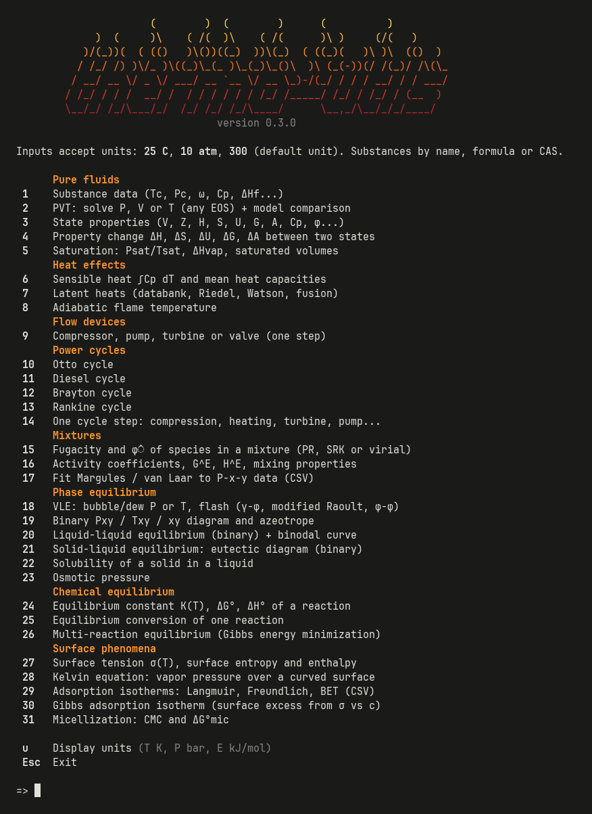
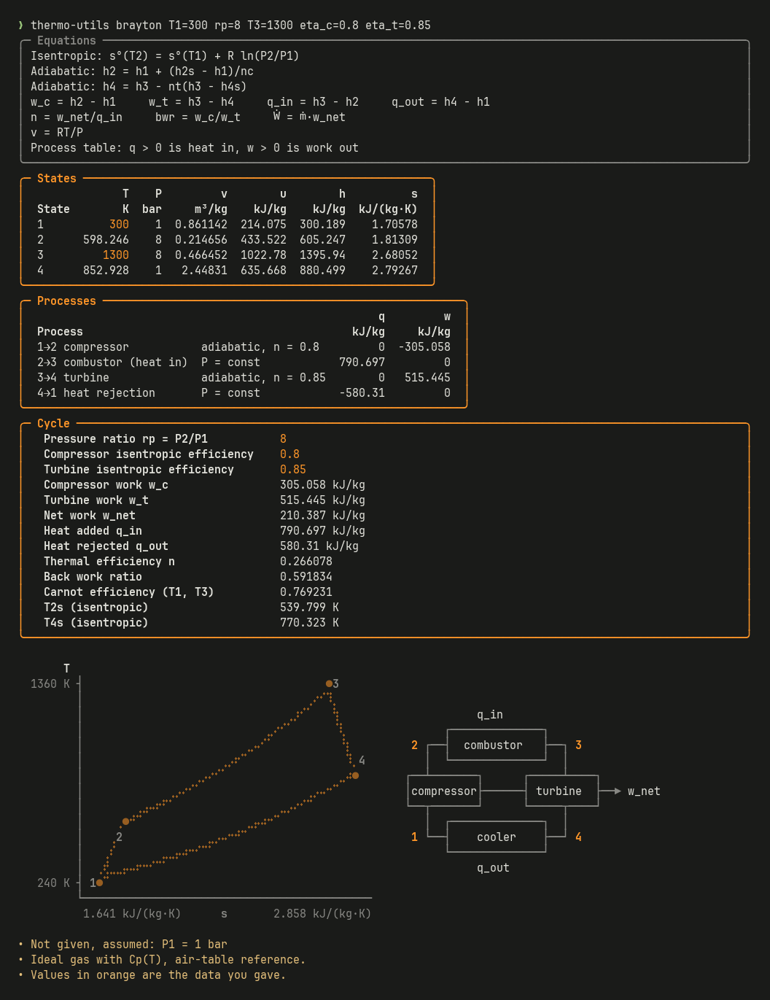
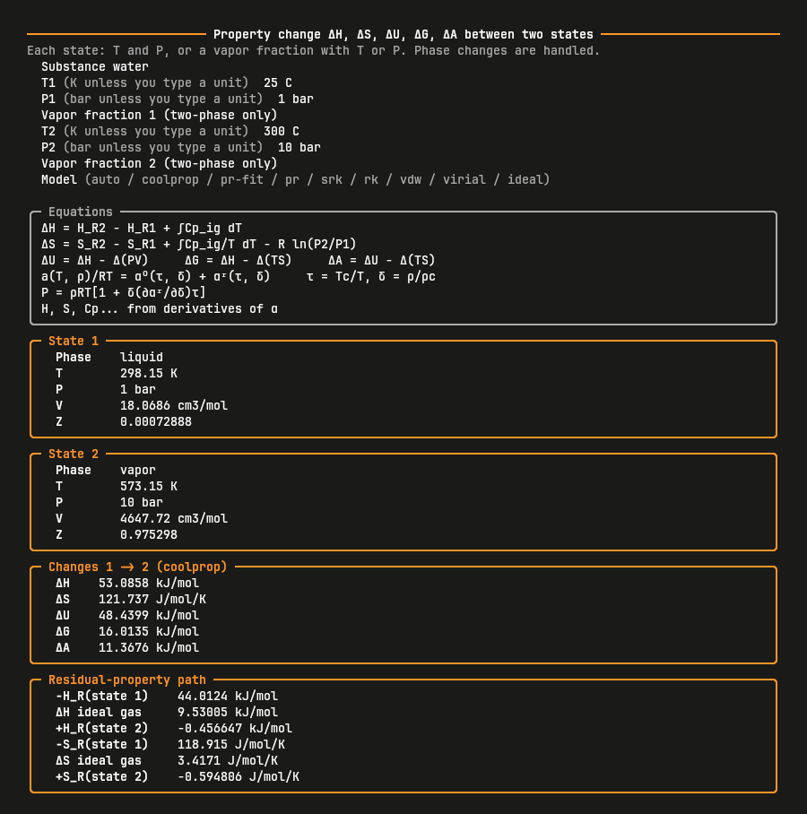

<div align="center">

<picture>
  <source media="(prefers-color-scheme: dark)" srcset="https://raw.githubusercontent.com/eggplanta/thermo-utils/main/docs/logo-dark.png">
  
</picture>


[](LICENSE)

</div>

**thermo-utils** is a command-line thermodynamics calculator for chemical engineering.
It covers pure fluids, heat effects, flow devices, cycles, humid air, mixtures, phase equilibrium, chemical equilibrium and surface phenomena, and is accurate enough for design work.
You only type the substance name: Tc, Pc, ω, Cp, ΔHf, Psat and the other data come from built-in databanks.

## Screenshots

<div align="center">

<table>
  <tr>
    <td align="center"><br><sub>Main menu</sub></td>
    <td align="center"><br><sub>Brayton cycle with its T-s diagram</sub></td>
  </tr>
  <tr>
    <td align="center" colspan="2"><br><sub>Property change between two states</sub></td>
  </tr>
</table>

</div>

## Installation

```bash
pipx install thermo-utils
```

or `uv tool install thermo-utils`, or `pip install thermo-utils` inside a virtual environment.

## Usage

Run `thermo-utils` to open the interactive menu (Esc exits), or run a calculation directly:

```bash
thermo-utils delta water T1=25C P1=1atm T2=300C P2=20bar
thermo-utils delta nitrogen T1=300 P1=1bar V2=3117cm3/mol dS=0
thermo-utils pump water T1=25C P1=1atm P2=50bar efficiency=0.75 flow=10kg/s
thermo-utils otto T1=27C P1=100kPa r=8 q_in=800
thermo-utils otto T1=27C P1=100kPa r=8 q_in=800 --details   # every step of the calculation
thermo-utils brayton T1=300 T3=1300 w_net=300 eta_c=0.85     # finds rp
thermo-utils rankine P1=10kPa P3=3MPa x3=1 Wdot=10MW eta_t=0.87
thermo-utils step steam-turbine P1=3MPa T1=350C P2=10kPa x2=0.9
thermo-utils refrigeration R134a T_evap=-25C T_cond=26C eta_c=0.8 Qdot_L=120000kJ/h
thermo-utils humid-air T=35C RH=40%
thermo-utils air-process dehumidify T1=30C RH1=80% V1=10m3/min T2=14C RH2=100%
thermo-utils diagram ethanol,water P=1atm --plot
thermo-utils rankine P1=10kPa P3=8.6MPa T3=500C --plot --csv   # P-v and T-s plots + result table
thermo-utils gibbs CH4,H2O,CO,CO2,H2 T=1000 P=1 feed=CH4=2,H2O=3
thermo-utils list           # every calculation and its inputs
thermo-utils info ammonia   # databank values of a substance
thermo-utils config         # create, check and locate the settings file
```

- **Units:** type them with the value (`25C`, `10atm`, `300cm3/mol`, `5kmol/h`), with no space so no quotes are needed. Without a unit the defaults are K, bar, cm³/mol and J/mol. Output units can be changed in the menu (`u`) or in the [settings file](#settings-file), both kept for later sessions, or for one run with `--T-unit`, `--P-unit`, `--E-unit`, `--V-unit`.
- **Substances:** English names, formulas or CAS numbers (`water`, `H2O`, `7732-18-5`), right after the calculation name. `air` is available as a pseudo-pure fluid (reference EOS of Lemmon et al., 2000), and so are the refrigerant blends R410A, R404A, R407C and R507A. Refrigerants can also be typed by R number (`R-32`, `R744`, `R290`). Mixtures are comma separated (`ethanol,water`).
- **Devices:** `pump`, `compressor`, `turbine` and `valve` are shortcuts for `device kind=...`.
- **Cycles:** give any values that fix the cycle (states `T1`...`P4`, `v`, `u`, `h`, `s`, `x`, or results like `r`, `rp`, `rc`, `q_in`, `w_net`, `eta`, `mep`, `Wdot`) and the rest is solved. Energies default to kJ/kg; `--E-unit kJ/mol` (and `--V-unit L/mol`) shows them per mole. Gas cycles use Cp(T); `k=1.4` switches to the cold air-standard.
- **Plot and Table (CSV):** after a result, **Plot** saves a PNG (with a CSV of the curve data) and **Table (CSV)** saves every computed value as `section, item, quantity, value, unit`; both open in the default app. Plots exist for cycles, devices, property changes, phase diagrams and the other calculations where a curve helps. Files go to the cache folder (`~/.cache/thermo-utils`, or `$THERMO_UTILS_PLOTS`), which keeps the latest 100. On the command line: `--plot`, `--csv`, and `--no-open` to only save.
- **Details:** after a result, **Show details** opens the step-by-step calculation, like a worked exercise: formulas, substituted values and the result of each step, iterations included (↑/↓ scroll, q goes back). On the command line, add `--details`.
- **Decimals:** results keep 6 significant figures with at least 4 decimal places (up to 10 significant figures), so `642.12` shows as `642.1203`. Change the minimum (2–8) in the menu (`u`) or with `--decimals N`. Values you type stay as typed.
- **Percent:** `0.2` and `20%` are the same; values without `%` are fractions (efficiencies, excess air, qualities).

## Calculations

**Pure fluids**
- PVT with ideal gas, virial, van der Waals, RK, SRK, Peng-Robinson, fitted Peng-Robinson and reference EOS, with a side-by-side comparison
- State properties: V, Z, H, S, U, G, A, Cp, Cv, φ, fugacity, κ, β, μJT, speed of sound
- Property changes ΔH, ΔS, ΔU, ΔG, ΔA between two states given by any two of T, P, V (phase changes included), with the residual-property path
- The reverse: the missing T, P or V of a state for a given ΔH, ΔS, ΔU, ΔG or ΔA (e.g. isentropic compression with ΔS = 0)
- Saturation (Psat, Tsat, ΔHvap)

**Heat effects**
- Sensible and latent heats (Riedel, Watson)
- Adiabatic flame temperature

**Flow devices**
- One-step devices: compressor, pump, turbine and valve, with efficiency and power for a given flow

**Cycles**
- Otto, Diesel, Brayton, Rankine and vapor-compression refrigeration (or heat pump), solved from any consistent data: known data in, the rest out, in either direction (e.g. r from η, T3 from q_in, rp from w_net, ṁ from the power)
- Isentropic efficiencies of compressor, turbine, pump and piston strokes; engine power from displacement and rpm
- Single steps (compression, expansion, heating at constant v or P, compressor, turbine, pump, boiler, condenser) solved the same way
- Air with Cp(T) on the air-table reference or the cold air-standard (constant k); Rankine with the reference EOS of water (or another fluid)
- Refrigeration with any refrigerant that has a reference EOS (R134a by default, ammonia, propane...) or the blends R410A, R404A, R407C and R507A (temperature glide noted): superheat and subcooling, COP of refrigerator, heat pump and Carnot, capacity in kW or tons of refrigeration (`TR`), T-s and P-h diagrams
- P-v or T-s diagram of the cycle (with the saturation dome for Rankine) and the equipment sketch, drawn in the terminal

**Humid air**
- State of humid air from any two of T, RH, ω, wet-bulb and dew-point temperatures and h (real humid air, ASHRAE RP-1485)
- Processes with mass and energy balances: cooling with dehumidification, adiabatic mixing of two streams, evaporative cooling; flows as dry-air mass or volume (m³/h, cfm...)

**Mixtures**
- Fugacity of species in mixtures (PR, SRK, virial) and the Lewis-Randall rule
- Activity coefficients and excess properties: Margules, van Laar, Wilson, NRTL, UNIQUAC, UNIFAC, UNIFAC-Dortmund
- Margules and van Laar fits from P-x-y data (CSV)

**Phase equilibrium**
- VLE: bubble/dew P and T and flash, using γ-φ, modified Raoult, Raoult or φ-φ, for multicomponent mixtures
- Pxy, Txy and xy diagrams with azeotrope detection
- LLE with the binodal curve, SLE (eutectic), solubility of solids, osmotic pressure

**Chemical equilibrium**
- K(T), ΔG° and ΔH° with rigorous ΔCp integration and the van 't Hoff plot
- Equilibrium conversion of one reaction: ideal gas, gas with virial φ̂, ideal liquid or UNIFAC
- Multi-reaction equilibrium by Gibbs energy minimization (no need to write the reactions)

**Surface phenomena**
- Surface tension σ(T) with surface entropy and enthalpy (databank, Brock-Bird, parachor)
- Adsorption isotherms (Langmuir, Freundlich, BET with specific surface area) fitted to CSV data

## Settings file

thermo-utils reads a settings file every time it starts, in the menu and on the command line, so it can be adapted to the way you work.
Run `thermo-utils config` to create it (with comments and examples), check it for mistakes and see where it is:

| System | Location |
|---|---|
| Linux | `~/.config/thermo-utils/settings.toml` |
| macOS | `~/Library/Application Support/thermo-utils/settings.toml` |
| Windows | `%APPDATA%\thermo-utils\settings.toml` |

The file is [TOML](https://toml.io): lines starting with `#` are comments, text goes in quotes, numbers and `true`/`false` do not.
The menu option `u` (Display units) also writes to it, changing only the values in `[display]` and keeping your comments and other sections.
Any mistake (an unknown unit, a misspelled key) is reported when the program starts, and the rest of the file still applies.

### Display units for every calculation

The `[display]` section sets the units of every result:

```toml
[display]
temperature = "°C"        # K, °C, °F, R
pressure = "kPa"          # Pa, kPa, MPa, bar, atm, psi, ...
specific_energy = "kJ/kg"
power = "kW"
min_decimals = 4          # 2 to 8; results keep 6 significant figures
typed_units_win = true    # units you type are kept in the results
hide_logo = true          # no logo when the menu opens
hide_equations = true     # no Equations box in the results
```

Keys left out keep their default. Energy units set the family (J or cal) and the basis (per mol or per kg); the k prefix is picked per result from the size of the values.

### Display units for one calculation

A `[display.<calculation>]` section **overrides `[display]` for that calculation only**. Its name is the calculation id from `thermo-utils list` (`refrigeration`, `rankine`, `delta`, `vle`, ...), and keys left out keep the `[display]` value.
For example, temperatures in °C in the refrigeration cycle and in K everywhere else:

```toml
[display]
temperature = "K"

[display.refrigeration]
temperature = "°C"
pressure = "kPa"
```

`hide_equations` works per calculation too, e.g. `[display.otto]` with `hide_equations = true` hides the equations of the Otto cycle only. `hide_logo` goes only in `[display]`.

When several settings apply, the first one in this list wins:

1. command-line options (`--T-unit`, `--decimals`, ...), for that run only
2. units typed with a value (`25C`, `10atm`), when `typed_units_win = true`
3. `[display.<calculation>]`
4. `[display]`

## Accuracy

| Model | Use | Typical error |
|---|---|---|
| Reference EOS ([CoolProp](https://coolprop.org)) | ~120 common fluids (water, CO₂, hydrocarbons, refrigerants, air gases...) | < 0.1 % in density and enthalpy |
| Fitted Peng-Robinson (Twu α + volume translation) | any substance in the databank | ~1 % in Psat, ~2 % in liquid density |
| Peng-Robinson / SRK | any substance in the databank | 1-5 % for gases, 5-30 % for liquid volumes |
| Virial (Pitzer) | gases at low to moderate pressure | < 1-2 % when Vr > 2 |
| UNIFAC / NRTL / UNIQUAC (ChemSep) | liquid mixtures | azeotropes within ~0.5 K for common systems |

The `auto` model uses the reference EOS when available and the fitted Peng-Robinson otherwise. Its α function and volume shift are fitted to the databank vapor pressure and liquid density of each substance.

Every result starts with the equations used in the calculation, and **Show details** lists each step with its numbers.
H, S, U, G and A share one reference state (ideal gas at 298.15 K and 1 bar), so differences between models are meaningful.
Data come from [chemicals](https://github.com/CalebBell/chemicals), [thermo](https://github.com/CalebBell/thermo) and CoolProp.

## Contributing

Contributions are very welcome! thermo-utils still has a lot of room to grow, and I'd be happy to get your help.
Found a wrong result, a missing substance or a bug? Have an idea for a new calculation? Open an [issue](https://github.com/eggplanta/thermo-utils/issues) or send a pull request.
