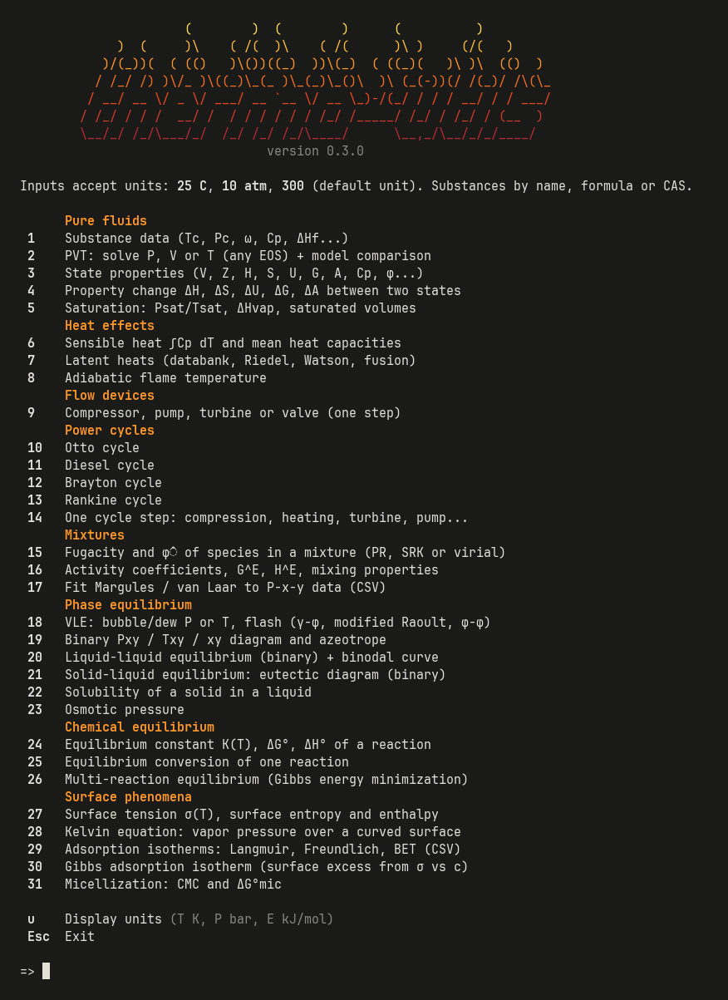
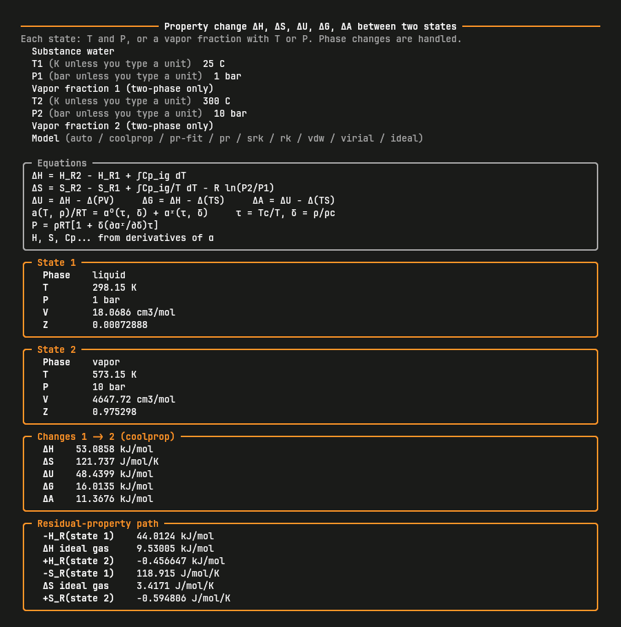

<div align="center">

<picture>
  <source media="(prefers-color-scheme: dark)" srcset="https://raw.githubusercontent.com/eggplanta/thermo-utils/main/docs/logo-dark.png">
  
</picture>


[](LICENSE)

</div>

**thermo-utils** is a command-line thermodynamics calculator for chemical engineering.
It covers pure fluids, heat effects, flow devices, mixtures, phase equilibrium, chemical equilibrium and surface phenomena, and is accurate enough for design work.
You only type the substance name: Tc, Pc, ω, Cp, ΔHf, Psat and the other data come from built-in databanks.

## Screenshots

<div align="center">

<table>
  <tr>
    <td align="center"><br><sub>Main menu</sub></td>
    <td align="center"><br><sub>Property change between two states</sub></td>
  </tr>
</table>

</div>

## Installation

```bash
pipx install thermo-utils
```

or `uv tool install thermo-utils`, or `pip install thermo-utils` inside a virtual environment.

## Usage

Run `thermo-utils` to open the interactive menu (Esc exits; the program closes after showing a result), or run a calculation directly:

```bash
thermo-utils delta water T1=25C P1=1atm T2=300C P2=20bar
thermo-utils pump water T1=25C P1=1atm P2=50bar efficiency=0.75 flow=10kg/s
thermo-utils diagram ethanol,water P=1atm --plot --open
thermo-utils gibbs CH4,H2O,CO,CO2,H2 T=1000 P=1 feed=CH4=2,H2O=3
thermo-utils list           # every calculation and its inputs
thermo-utils info ammonia   # databank values of a substance
```

- **Units:** type them with the value (`25C`, `10atm`, `300cm3/mol`, `5kmol/h`), with no space so no quotes are needed. Without a unit the defaults are K, bar, cm³/mol and J/mol. Output units can be changed in the menu (`u`) or with `--T-unit`, `--P-unit`, `--E-unit`, `--V-unit`.
- **Substances:** English names, formulas or CAS numbers (`water`, `H2O`, `7732-18-5`), right after the calculation name. Mixtures are comma separated (`ethanol,water`).
- **Devices:** `pump`, `compressor`, `turbine` and `valve` are shortcuts for `device kind=...`.
- **Plots:** saved as PNG in `./thermo-plots` (or `$THERMO_UTILS_PLOTS`) and opened on request.

## Calculations

**Pure fluids**
- PVT with ideal gas, virial, van der Waals, RK, SRK, Peng-Robinson, fitted Peng-Robinson and reference EOS, with a side-by-side comparison
- State properties: V, Z, H, S, U, G, A, Cp, Cv, φ, fugacity, κ, β, μJT, speed of sound
- Property changes ΔH, ΔS, ΔU, ΔG, ΔA between two states, including phase change, with the residual-property path
- Saturation (Psat, Tsat, ΔHvap)

**Heat effects**
- Sensible and latent heats (Riedel, Watson)
- Adiabatic flame temperature

**Flow devices**
- One-step devices: compressor, pump, turbine and valve, with efficiency and power for a given flow

**Mixtures**
- Fugacity of species in mixtures (PR, SRK, virial) and the Lewis-Randall rule
- Activity coefficients and excess properties: Margules, van Laar, Wilson, NRTL, UNIQUAC, UNIFAC, UNIFAC-Dortmund
- Margules and van Laar fits from P-x-y data (CSV)

**Phase equilibrium**
- VLE: bubble/dew P and T and flash, using γ-φ, modified Raoult, Raoult or φ-φ, for multicomponent mixtures
- Pxy, Txy and xy diagrams with azeotrope detection
- LLE with the binodal curve, SLE (eutectic), solubility of solids, osmotic pressure

**Chemical equilibrium**
- K(T), ΔG° and ΔH° with rigorous ΔCp integration and the van 't Hoff plot
- Equilibrium conversion of one reaction: ideal gas, gas with virial φ̂, ideal liquid or UNIFAC
- Multi-reaction equilibrium by Gibbs energy minimization (no need to write the reactions)

**Surface phenomena**
- Surface tension σ(T) with surface entropy and enthalpy (databank, Brock-Bird, parachor)
- Kelvin equation (vapor pressure over drops, bubbles and pores)
- Adsorption isotherms (Langmuir, Freundlich, BET with specific surface area) fitted to CSV data
- Gibbs adsorption isotherm (Szyszkowski fit), micellization (CMC, ΔG°mic)

## Accuracy

| Model | Use | Typical error |
|---|---|---|
| Reference EOS ([CoolProp](https://coolprop.org)) | ~120 common fluids (water, CO₂, hydrocarbons, refrigerants, air gases...) | < 0.1 % in density and enthalpy |
| Fitted Peng-Robinson (Twu α + volume translation) | any substance in the databank | ~1 % in Psat, ~2 % in liquid density |
| Peng-Robinson / SRK | any substance in the databank | 1-5 % for gases, 5-30 % for liquid volumes |
| Virial (Pitzer) | gases at low to moderate pressure | < 1-2 % when Vr > 2 |
| UNIFAC / NRTL / UNIQUAC (ChemSep) | liquid mixtures | azeotropes within ~0.5 K for common systems |

The `auto` model uses the reference EOS when available and the fitted Peng-Robinson otherwise. Its α function and volume shift are fitted to the databank vapor pressure and liquid density of each substance.

Every result starts with the equations used in the calculation.
H, S, U, G and A share one reference state (ideal gas at 298.15 K and 1 bar), so differences between models are meaningful.
Data come from [chemicals](https://github.com/CalebBell/chemicals), [thermo](https://github.com/CalebBell/thermo) and CoolProp.

## Contributing

Contributions are very welcome! thermo-utils still has a lot of room to grow, and I'd be happy to get your help.
Found a wrong result, a missing substance or a bug? Have an idea for a new calculation? Open an [issue](https://github.com/eggplanta/thermo-utils/issues) or send a pull request.
